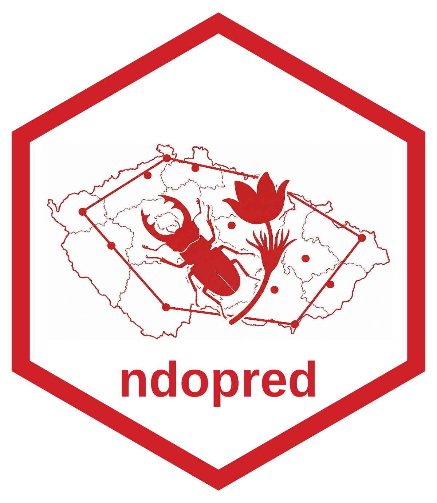

# ndopred: NDOP Red List Assessor 

**ndopred** turns occurrence records from **NDOP** (*Nálezová databáze ochrany přírody*, the Czech Nature Conservation Agency's species occurrence database) into proposed IUCN Red List categories for the Czech national list, with the evidence behind each proposal and what still needs evidence.

It follows the **IUCN Red List Categories and Criteria v3.1** (IUCN 2012), the **Guidelines for Using the IUCN Red List Categories and Criteria v16** (March 2024) and the **Guidelines for Application of IUCN Red List Criteria at Regional and National Levels v4.0** (2012). All three are in [`methodology/`](methodology/). [`methodology/gap_analysis.md`](methodology/gap_analysis.md) records how the package is being aligned with them, phase by phase.

> Rendering the vignette needs [pandoc](https://pandoc.org/installing.html) (RStudio and Quarto bundle it). Without pandoc, `R CMD INSTALL .` still works; only `R CMD build` and `vignette("methodology")` need it.

---

## Contents

- [How a category is proposed](#how-a-category-is-proposed)
- [The two apps](#the-two-apps)
- [Installation](#installation)
- [Credentials](#credentials)
- [Quick start](#quick-start)
- [Function reference](#function-reference)
- [The bulk export](#the-bulk-export)
- [The single-species app](#the-single-species-app)
- [Methodology notes](#methodology-notes)
- [Testing](#testing)

---

## How a category is proposed

Every entry point (both apps, `assess_species()`, `batch_assess()`) runs the same rule engine and reports five things for each taxon:

1. **A proposed category** with the criteria behind it, in ndopred's established format (`B1ab(ii); B2ab(ii)`) and in IUCN notation (`B1ab(ii)+2ab(ii)`).
2. **Its support.** *Evidenced* means every condition behind the proposal comes from the assessor or from a measured value. *Indication* means at least one condition rests on a proxy from the records, such as 5 km clusters standing in for threat-defined locations, or the raw change in AOO between two windows standing in for a decline.
3. **What still needs evidence**, condition by condition, e.g. `B(a): severe fragmentation or threat-defined locations (5 km clusters used as an indication)`.
4. **The plausible range** of categories, from the largest plausible EOO and AOO to the smallest plausible ones with the unknown conditions true, e.g. `LC-EN`.
5. **Whether it is uncertain**: the range holds both a non-threatened category (LC, NT) and a threatened one (VU, EN, CR).

What the records cannot show is never assumed absent. An unknown condition is **unknown**: it does not count against the taxon in the proposal, but it widens the range and appears in "needs evidence".

The proposal is the **best estimate** (AOPK decision D7). Uncertainty never changes it; it is flagged. Guidelines §10.1 allows NT for a taxon whose range holds LC and VU or EN, and DD when every category from LC to CR is plausible; §10.4 leaves that choice to the assessor's risk tolerance. The flag says which applies. ndopred itself proposes NT only where a criterion is nearly met.

The proposal is step two of the regional procedure (Regional Guidelines v4.0). **Step one** decides whether the regional population is assessed at all: introduced taxa, vagrants, occasional breeders and colonizers reproducing for fewer than 10 years are Not Applicable (NA). **Step three** adjusts the category for populations outside Czechia, normally by one step down when immigration rescues the regional population, and marks it with a degree sign (`VU°`). Without regional evidence a taxon is assessed and left unchanged, as the Guidelines require when the influence of outside populations is unknown.

The proposal is not a final category. Approval belongs to group experts.

---

## The two apps

```r
library(ndopred)

run_bulk_app()   # screen a whole spreadsheet of taxa
run_app()        # assess one taxon at a time, as an expert
```

| | `run_bulk_app()` | `run_app()` |
|---|---|---|
| **Input** | CSV with a `TAXON` column | one scientific name |
| **Pipeline** | `assess_taxon()` | `assess_taxon()`, plus the assessor's evidence |
| **NDOP counts (C, D)** | not used | used as indications when the count basis supports it |
| **Output** | one row per taxon + a map per taxon (CSV + ZIP) | the proposal, its evidence table, and the assessor's view |

Both apps compute identical numbers for identical inputs.

---

## Installation

```r
# install.packages("remotes")
remotes::install_github("jonasgaigr/ndopred")
```

`rndop` comes from GitHub and is declared in `Remotes:`. If you install by hand:

```r
remotes::install_github("kalab-oto/rndop")
install.packages(c("dplyr", "ggplot2", "giscoR", "magrittr", "sf", "shiny",
                   "shinythemes", "terra", "units", "zip"))
install.packages("igraph")   # required by calculate_locations()
```

---

## Credentials

NDOP requires a login. Everything that downloads data needs `NDOP_USER` and `NDOP_PWD` in the environment, usually stored in `.Renviron`:

```
NDOP_USER='your.username'
NDOP_PWD='your password'
```

⚠️ **Three gotchas:**

1. **Which `.Renviron` is read depends on how R starts.** R started from RStudio, Rgui or PowerShell on Windows reads `~/Documents/.Renviron`. `Rscript` from Git Bash reads `C:/Users/<you>/.Renviron`. Keep both in step, or check with `path.expand("~/.Renviron")`.
2. **A failed login deletes the credentials.** If a login gets no session cookie back, `rndop::isop_login()` removes every `NDOP_*` line from `$HOME/.Renviron`. That happens on a wrong password, and also when the server returns an error or maintenance page. Keep a copy.
3. `isop_login()` keeps its session cookie in `.GlobalEnv` of the R session that ran it; other processes log in again from the environment variables.

The password is stored in plain text, so restrict the file's permissions. A failed download is reported in the output (`issue_download`) and never turned into a category.

---

## Quick start

### One taxon

```r
library(ndopred)

assess_species("Lucanus cervus",
               recent_start = 2010, recent_end = 2026,
               comp_start   = 2000, comp_end   = 2016)
```

The reference year defaults to `recent_end`. The assessor's evidence can be passed straight through:

```r
assess_species("Bombina bombina",
               recent_start = 2010, recent_end = 2026,
               comp_start   = 2000, comp_end   = 2016,
               d2_threat = "drainage of breeding ponds",   # describe the threat
               threat_locations = 8,
               habitat_decline = TRUE)                       # B(b)(iii)
```

### Many taxa

```r
batch_assess(c("Lucanus cervus", "Bombina bombina", "Pulsatilla vernalis"),
             reference_year = 2026)   # 2010-2026 against 2000-2016
```

A taxon that fails keeps its row: the category is `NA` and an `issue_*` column says why.

### Snapshots: repeatable runs

Pass a folder and every download is stored unchanged as an RDS snapshot, so the same assessment can be rerun on exactly the same records:

```r
batch_assess(c("Lucanus cervus", "Bombina bombina"), reference_year = 2026,
             snapshot_dir = default_snapshot_dir())   # Documents/ndop_snapshots
# ... later, on the same data:
occ <- get_assessment_data("Bombina bombina",
                           snapshot = "C:/Users/<you>/Documents/ndop_snapshots/Bombina_bombina_<time>.rds")
```

Snapshots hold exact (including hidden) coordinates and observer names: keep the folder out of shared repositories.

### Step by step

```r
cfg <- ndopred_config(reference_year = 2026)   # AOPK windows: 2010-2026 vs 2000-2016
occ <- get_assessment_data("Bombina bombina")
table(occ$include)                  # every record is kept; exclusions are flags
attr(occ, "exclusions")             # how many records were excluded, and why
attr(occ, "filter_counts")          # records left after each successive test

m <- taxon_metrics(occ, cfg)        # EOO, AOO, clusters, trend, counts, issues
res <- assess_taxon(species = "Bombina bombina", config = cfg, metrics = m,
                    evaluate_pop = TRUE,
                    evidence = list(threat = "drainage of breeding ponds",
                                    threat_locations = 8))
res$proposal                        # category, criteria, support, needs, range, uncertain
res$assessment$table                # one row per criterion x subcriterion x level
```

The engine can also be driven from your own numbers:

```r
inp <- assessment_inputs(
  eoo_km2 = 1700, aoo_km2 = 84, n_records = 40, n_current = 12, year_last = 2025,
  evidence = list(threat = "drainage of the two remaining fens",
                  threat_locations = 2, decline = c(iii = TRUE))
)
categorise(assess_criteria(inp, ndopred_config(2025)))
#> Proposed: EN B1ab(iii)+2ab(iii)
```

### A map

```r
w <- cfg$windows                     # the windows the assessment used
p <- plot_iucn("Bombina bombina", occ_data = occ,
               recent_start = w$recent_start, recent_end = w$recent_end,
               comp_start = w$comp_start, comp_end = w$comp_end)
ggplot2::ggsave("bombina.png", p, width = 8, height = 6, dpi = 150, bg = "white")
```

---

## Function reference

**Configuration and engine**

| Function | Purpose |
|---|---|
| `ndopred_config()` | Everything a run depends on: reference year, windows, generation length, labelled conventions, versions |
| `generation_lengths_refined()`, `generation_length_for()`, `generation_length_set()` | Generation length of a taxon: by species, genus, family, then NDOP group (refined set, the default; AOPK, D15), with its source |
| `generation_lengths()` | The superseded 1-year placeholder per NDOP group (`set = "placeholder"`) |
| `assessment_inputs()` | Data, indications and evidence for one taxon |
| `assess_criteria()` | The single rule engine: criteria A-E in two scenarios, plus a tidy evidence table |
| `categorise()` | The proposal: category, criteria (both formats), support, needs, range, flags |

**Pipeline**

| Function | Purpose |
|---|---|
| `ndop_snapshot()`, `read_ndop_snapshot()`, `latest_snapshot()`, `default_snapshot_dir()` | Store a download unchanged (records and their points, lines and polygons), read it back, find a taxon's latest one |
| `flag_records()` | One flag per quality test and an `exclusion_reason`; deletes nothing |
| `get_assessment_data()` | Snapshot plus flags, as points, with the record geometries and any download error attached |
| `taxon_metrics()` | Metrics for one taxon, with a reason for every value it cannot compute |
| `assess_taxon()` | Records in, proposal out: what both apps and `batch_assess()` use |
| `assess_species()`, `batch_assess()` | The pipeline for one or many taxa, headless |

**Expert evidence and the final category**

| Function | Purpose |
|---|---|
| `evidence_fields()`, `evidence_template()` | The fields an expert may give, and a CSV or XLSX template to fill offline |
| `read_evidence()`, `validate_evidence()` | Import and check an evidence file; every problem is reported with its row |
| `write_evidence()`, `latest_evidence()` | Store evidence as a new dated version, never overwriting; find the newest |
| `evidence_for_engine()`, `apply_record_evidence()` | Turn evidence into engine inputs, record flags and config overrides |
| `final_assessment()` | Check the final category against what the evidence supports, and its approval |
| `species_card()` | One assessment on one HTML page |

**Metrics**

| Function | Purpose |
|---|---|
| `calculate_eoo()` | Extent of occurrence, minimum convex polygon (Guidelines §4.9), with bounds from positional precision |
| `calculate_aoo()` | AOO on the 2 x 2 km reference grid, minimised over grid origins (§4.10.2, §4.10.3; exactly for up to 150 distinct positions), with bounds from positional precision and record polygons |
| `calculate_locations()` | 5 km cluster count: an *indication* for threat-defined locations (§4.11), never a location count |
| `reconcile_eoo_aoo()` | Enforce EOO >= AOO (§4.9) |
| `calculate_trend()` | AOO and EOO change between two windows, on a shared grid origin |
| `calculate_pop_metrics()` | Minimum observed counts, decline rate, fluctuation diagnosis (§4.3, §4.5.1, §4.7) |
| `get_mature_terms()` | The `POCITANO` values that assert reproductive capability (§4.3) |

**Deprecated, kept for existing scripts:** `summarize_assessment()`, `assess_criterion_a()`, `assess_criterion_d2()`.

**Trends** (review Table 5; Guidelines §4.5, §4.9)

| Function | Purpose |
|---|---|
| `trend_estimate()`, `data_tier()` | The data tier T0-T3 of a taxon and the trend estimate it allows, with its interval and start-year sensitivity |
| `trend_settings()` | Conventions of the trend module: thresholds per tier, monitoring projects (T3), the occupancy model (T2) |
| `monitoring_projects()` | AOPK's list of NDOP projects for T3 (D14) |
| `ndop_effort()`, `effort_layer()`, `read_effort()`, `cadastral_units()` | Recording effort of an NDOP group (cells and visits, no names), downloaded once and cached; for a large group, a random sample of cadastral units (`units`) |
| `calculate_eoo_alpha()` | EOO as an alpha-hull, the measure for change in EOO (§4.9) |

**Regional step** (Regional Guidelines v4.0)

| Function | Purpose |
|---|---|
| `regional_eligibility()` | Step one: is the regional population assessed, or Not Applicable? |
| `regional_adjustment()` | Step three: questions 3a-3f, down- or uplisting with the degree sign |
| `regional_assessment()` | Both steps around a step-two category, with the global category and share |

**Checking the method** (review §9, §10)

| Function | Purpose |
|---|---|
| `compare_tools()` | The same records through ndopred, ConR, redlistr and red: EOO, AOO, locations and the criterion B category side by side |
| `compare_categories()` | Proposals beside another list of categories (e.g. the current Red List), sorted by agreement and by the direction of each disagreement; neither side taken as the truth (D17) |
| `filter_stability()`, `filter_variants()`, `region_variants()` | Reassess under alternative record filters (unvalidated, less credible, literature, imprecise, 10 % data loss, one region at a time) and report what changes |
| `export_dictionary()` | Every column of both exports: meaning, values, layer, IUCN section, candidate SIS field |

**Presentation:** `plot_iucn()`, `run_app()`, `run_bulk_app()`.

---

## The bulk export

Upload a CSV with `TAXON` (required), and optionally `CELED`, `SKUPINA` and `ID_TAXON` (for a link to the species card on portal.nature.cz). Set the reference year, the length of the current window (AOPK default 17 years: 2010–2026 for 2026) and how far back the comparison window lies (default 10 years: 2000–2016).

The established columns are unchanged. `Kategorie (automatická)` holds the proposed category and `Kriteria (automatická)` the criteria behind it, in the established format. The new columns are:

| Column | Content |
|---|---|
| `Kritéria (IUCN zápis)` | The same criteria in IUCN Annex 2 notation (`B1ab(ii)+2ab(ii)`, `D` under CR/EN, `D1+2`) |
| `Opora návrhu` | `doloženo` (evidenced), `indikace z nálezových dat` (rests on indications), `kandidát` (RE/DD candidate), `nehodnoceno` (NE) |
| `Nutno doložit` | What still needs evidence, condition by condition |
| `Rozsah kategorií` | Plausible range, e.g. `LC-EN` |
| `Příznaky` | Flags: `Uncertain: plausible range LC-EN - NT may be chosen (Guidelines 10.1)`, `D2 candidate`, `DD candidate (plausible range LC-CR)`, `RE candidate` |
| `AOO nový, zvolená mřížka (km2)` | AOO on the display grid chosen in the app (the B2 value is always on 2 x 2 km) |
| `Referenční rok` | The reference year of the run |
| `AOO nový min/max (km2)`, `EOO nový min/max (km2)` | Bounds from positional precision and record polygons |
| `Záznamů vyřazeno`, `Důvody vyřazení` | How many records were excluded, and why |
| `Snapshot NDOP` | The snapshot file the row was computed from (when snapshots are stored) |
| `Nejistý návrh` | `ano` when the plausible range holds both a non-threatened and a threatened category (AOPK, D7) |
| `Generační doba (roky)`, `Zdroj generační doby` | The generation length used and where it came from (the row of the refined tables that matched, by default) |
| `Kategorie (finální)` | The assessor's final category, once approved (with an evidence file) |
| `Stav finální kategorie` | `approved`, `approved; inconsistent with the evidence`, `awaiting approval` or `no final category` |
| `Nesoulad finální kategorie s doklady` | Where the final category and the evidence disagree |
| `Kategorie (regionální)`, `Kritéria (regionální)` | After the regional step: `NA` from step one, or the category adjusted in step three (`NT°`) |
| `Regionální krok` | Why: the step-one reason and the step-three answers |
| `Globální kategorie`, `Podíl globální populace (%)` | Published beside the regional category (Regional Guidelines V.4); `?` when the share is unknown |
| `Úroveň dat (T0-T3)`, `Odhad trendu (%)`, `Zdroj trendu` | The data tier, the trend estimate with its interval, and what it rests on |
| `Citlivost trendu na začátek období` | The raw AOO change for comparison windows starting two years earlier to two years later |
| `Priorita pro experty`, `Třídění pro experty` | The expert queue: `1` where CR or EN is possible (or an RE candidate), `2` VU (or a DD candidate), `3` NT, `4` an LC candidate (no criterion met even with every unknown met; still checked by an expert, never LC), `0` rerun |
| `issue_download` … `issue_population` | The reason for every empty value |

Every column of both exports is described in `export_dictionary()` (also printed in the methodology vignette).

The app stores snapshots in `Documents/ndop_snapshots` by default; untick *Store NDOP snapshots* to skip it. An optional **evidence file** (one for any number of taxa) adds the experts' evidence, record flags and final categories; with evidence, the proposal in `Kategorie (automatická)` uses it.

---

## The single-species app

Enter a name and the reference year, press **Run Assessment**. The *automated proposal* comes from the records alone. Enter your name as the **assessor**: every entry is recorded with it, the date and the panel's justification and sources.

- **Expert Review.** Every entry starts as *unknown*; whatever the assessor enters becomes evidence and replaces the indication for that condition: severe fragmentation; the most serious plausible threat (a description), or "no plausible threat"; threat-defined locations with the §4.11 basis; continuing decline and extreme fluctuations, confirmed or ruled out; population figures; a reduction with its A subcriterion, basis and, for A1, its causes; criterion E. Numbers take a best estimate and optionally a minimum and maximum, which widen the plausible range (§3.2).
- **Records.** Exclude NDOP records by `ID_NALEZ` (misidentification, introduction, vagrant, duplicate, imprecise, other), or use records the automatic flags excluded. The map shows excluded records as red crosses.
- **Final category.** The assessor's category, criteria and justification, checked live against what the evidence supports (e.g. "EN claimed under B with only one of (a), (b), (c) evidenced"), and the approvals by group experts (AOPK decision D9). It is final once approved on or after its date.
- **Evidence table.** The evidence in force, and every criterion, subcriterion and level with its value, threshold, support and source.

The **Expert view** updates live and equals the automated proposal until something is entered. Evidence is loaded from and saved to a CSV (or loaded from XLSX); *Save as a new version* writes a dated file to the evidence folder (`Documents/ndop_evidence` by default) and never overwrites one. **Species card** downloads the assessment as one HTML page.

## Expert evidence without the app

```r
evidence_template("Bombina bombina", file = "bombina_evidence.xlsx")   # fill it offline
ev <- read_evidence("bombina_evidence.xlsx")      # every problem reported with its row
res <- assess_taxon(get_assessment_data("Bombina bombina"), "Bombina bombina",
                    ndopred_config(2026), evidence = ev)
res$final                                         # final category, status, checks
species_card(res, file = "bombina_card.html")
batch_assess(taxa, reference_year = 2026, evidence = "all_groups_evidence.csv")
```

Each row names the taxon, the field (`evidence_fields()`), the value or `min`/`best`/`max`, the author, date (YYYY-MM-DD) and justification; sources are recommended (and required for criterion E). The latest entry for a field is the one in force. Evidence never edits NDOP data: record entries become flags, and computed values and evidence are shown side by side.

---

## Methodology notes

- **No record is deleted.** `flag_records()` adds a flag per test and the first exclusion reason. The rules agreed with AOPK:
  - `VEROH` 6 and 9 (erroneous) are excluded; 0 (not yet validated) and 1 (credible) are used.
  - `VEROH` 3 (less credible) is always used. It is flagged only when more than 10 % of the taxon's records carry it.
  - A proposed validation mark (`VALIDACE`) on an unguaranteed record is only flagged.
  - Negative findings are kept as non-detections.
  - Records of another taxon (names match exactly, so the query's hybrids and aggregates are excluded), records without coordinates, and records outside Czechia are excluded.
  - Literature and collection records and suspected duplicates are flagged only. Literature is recognised by markers in `ZDROJ` (card index, collection, museum, herbarium, atlas, literature data, journal volume with pages): a heuristic, since NDOP cites field notes and survey reports in the same "AUTHOR (year) title" form.
- **Windows (AOPK, D5).** The current window is the 17 years up to the reference year (2010–2026); the trend compares it with 2000–2016. The two windows' midpoints are 10 years apart, the period of criterion A; where three generations are longer, the comparison window moves back by three generations. They share 2010–2016, which damps the measured change: a site lost after 2010 still counts as current if it was recorded before the loss. For the same reason the criterion B window can hold sites lost since 2010, which §4.9 asks to leave out.
- **Generation lengths per taxon** (AOPK, D15). The refined tables (`generation_lengths_refined()`; sources and method in [`methodology/generation_lengths/`](methodology/generation_lengths/)) give every vertebrate and every Habitats Directive taxon its own value, and other taxa a genus, family or NDOP-group value. Up to 3.3 years a generation length changes no period. A value given for a taxon wins. The comparison window does not start before 2000 (`time_depth_start`); for long-lived taxa the trend issue says that the change covers fewer years than the criterion A period. The superseded 1-year placeholder per group stays available (`generation_length_set("placeholder")`).
- **Date ranges count only where they fit.** A record dated 1995–2012 belongs to neither 2000–2016 nor 2010–2026.
- **AOO and EOO have ranges.** `CXPRESNOST` 0 means an exact position. A record whose precision disc, or NDOP polygon, reaches into other 2 x 2 km cells widens AOO to a minimum and a maximum around the best estimate. These bound the *observed* AOO; for an under-recorded taxon the true AOO can be larger (§4.10.8).
- **Unknown is not "no".** Severe fragmentation, habitat decline and the threat default to unknown. A restricted taxon with nothing evidenced is proposed as LC, flagged uncertain, with a range reaching CR and the missing conditions listed; the same taxon with the conditions evidenced absent is LC without the flag (Guidelines §10.1).
- **D2 needs a described threat.** A restricted range is flagged as a D2 candidate; VU D2 follows once the assessor names a plausible threat able to drive the taxon to CR or EX in a very short time (§8). `d2_threat = TRUE` alone is not a threat and is treated as unknown.
- **Clusters are not locations.** The 5 km cluster count is an indication for B(a) and D2, always listed as needing threat-defined locations (§4.11). With no plausible threat, the location subcriteria are not met.
- **Trends follow the data tier** (review, Table 5). **T0**, records only: the raw change in AOO and in alpha-hull EOO, with the range from moving the comparison window two years either way; a diagnostic, not a population trend. **T1**, with an effort layer of the group (`ndop_effort()`): relative occupancy on the cells recorded for the group in both windows, an interim proxy with a bootstrap interval. **T2**, repeat visits: an occupancy-detection model (spOccupancy) when switched on. **T3**, counts from the monitoring projects AOPK lists (`monitoring_projects()`, D14) at sites counted in two or more years: an abundance index (basis b). Inventories and habitat mappings on the list visit most sites once, and those sites do not count. Each estimate is an indication with its interval; a continuing decline is indicated only when the whole interval says so. The needs list says what each tier still lacks (a monitored estimate for T0/T1; the link from occupancy to population for T2).
- **Minimum data quality** (Guidelines Table 3.1): expert evidence below the minimum of its criterion (a suspected decline for B or C2; inferred numbers for C, D or C2a(i); an inferred decline for C1) is documented but not used. C1 needs an estimated decline, so only standardized monitoring (T3) or evidence gives it, and only T3 counts diagnose extreme fluctuations.
- **The regional step needs experts.** Eligibility (origin, occurrence, years of reproduction, share of the global population), the step-three questions 3a-3f, the number of steps and the global category are evidence entries. AOPK decided not to filter taxa by their share of the global population (D16); `ndopred_config(regional_filter_share)` stays off. A final category one step below what the evidence supports is consistent when the step-three answers give that downlisting.
- **RE and DD are candidates, NE is "not evaluated".** A taxon not recorded for longer than `re_candidate_years` (a convention, default 50) is an RE candidate needing documented surveys (Regional Guidelines III.14). DD is proposed only for a taxon with records but none current and nothing else to go on, and is flagged when the range spans LC to CR (§10.1, §10.4). A taxon with no usable records is NE (§10.4).
- **Notation follows Annex 2** in `Criteria_IUCN` / `Kritéria (IUCN zápis)`: `CR D` and `EN D` (not `D1`), `B1…+2…`, `C2a(i,ii)`, `VU D1+2`.
- **No system clock.** Every run states its reference year.
- **Counts are minima.** `total_mature` and `max_subpop` are minimum observed values from opportunistic records, and NDOP *localities* stand in for subpopulations, so both are indications (§4.2, §4.3). `total_mature` sums each locality's most recent count, with the latest year and the per-locality maxima as its range.

---

## Testing

```r
devtools::test()
```

The suite covers:
- the engine at every threshold boundary;
- the IUCN Annex 2 and Guidelines §8.2/§8.3 worked examples;
- all 42 gaps from the Phase 0 audit, now closed (`test-iucn-alignment.R`);
- the evidence layer, the regional step and the trend tiers, including a small occupancy model when spOccupancy is installed;
- both Shiny apps end-to-end against a synthetic NDOP fixture (`tests/testthat/helper-mock-ndop.R`);
- cross-checks of EOO and AOO against redlistr and ConR, and of the criterion B category against ConR, when they are installed;
- the stability and comparison tools, and the export dictionary, which must list every column of both exports.

## Benchmark and checks on real data

Two scripts in `inst/` run the checks of review §9 on real data (they use the latest stored snapshot of each taxon, or download one):

```sh
# ndopred against ConR, redlistr and red on the pilot taxa
Rscript inst/benchmark/benchmark_tools.R --year 2026 --out benchmark.csv

# stability under alternative record filters; optionally a comparison with another list
Rscript inst/validation/check_proposals.R --taxa taxa.csv --year 2026 [--compare redlist.csv] [--regions]
```

`taxa.csv` has a `taxon` column (and optionally `group`); a `--compare` list has `taxon` and `category`. There is no validation against expert categories as a gold standard: experts often depart from the IUCN criteria (AOPK, D17), so the reference is the criteria themselves, and a disagreement with any list is a question to settle against the criteria and the evidence. ConR is installed from GitHub (`remotes::install_github("gdauby/ConR")`), redlistr and red from CRAN. The vignette reports the benchmark on three taxa: EOO agrees with redlistr exactly and with ConR within 0.3 %; ConR's AOO is 5-14 % higher, from its cylindrical projection; ConR's criterion B assumes a continuing decline, which ndopred never does.

---

## Logo


The `ndopred` logo showcases a silhouette of a [European stag beetle](https://portal.nature.cz/w/druh-6707#/) (*Lucanus cervus*) and [spring pasqueflower](https://portal.nature.cz/w/druh-39051#/) (*Pulsatilla vernalis*).

## Status

Version 0.11.0 (experimental). All phases of the IUCN alignment are done, with AOPK's decisions on generation lengths, T3 projects, the regional filter and validation (D14-D17). Proposals are a screening aid; the final category is the assessor's, approved by group experts.

## References

IUCN (2012). *IUCN Red List Categories and Criteria: Version 3.1*, 2nd edition. Gland, Switzerland and Cambridge, UK: IUCN.

IUCN (2012). *Guidelines for Application of IUCN Red List Criteria at Regional and National Levels: Version 4.0*. Gland, Switzerland and Cambridge, UK: IUCN.

IUCN Standards and Petitions Committee (2024). *Guidelines for Using the IUCN Red List Categories and Criteria*, Version 16. <https://www.iucnredlist.org/documents/RedListGuidelines.pdf>
